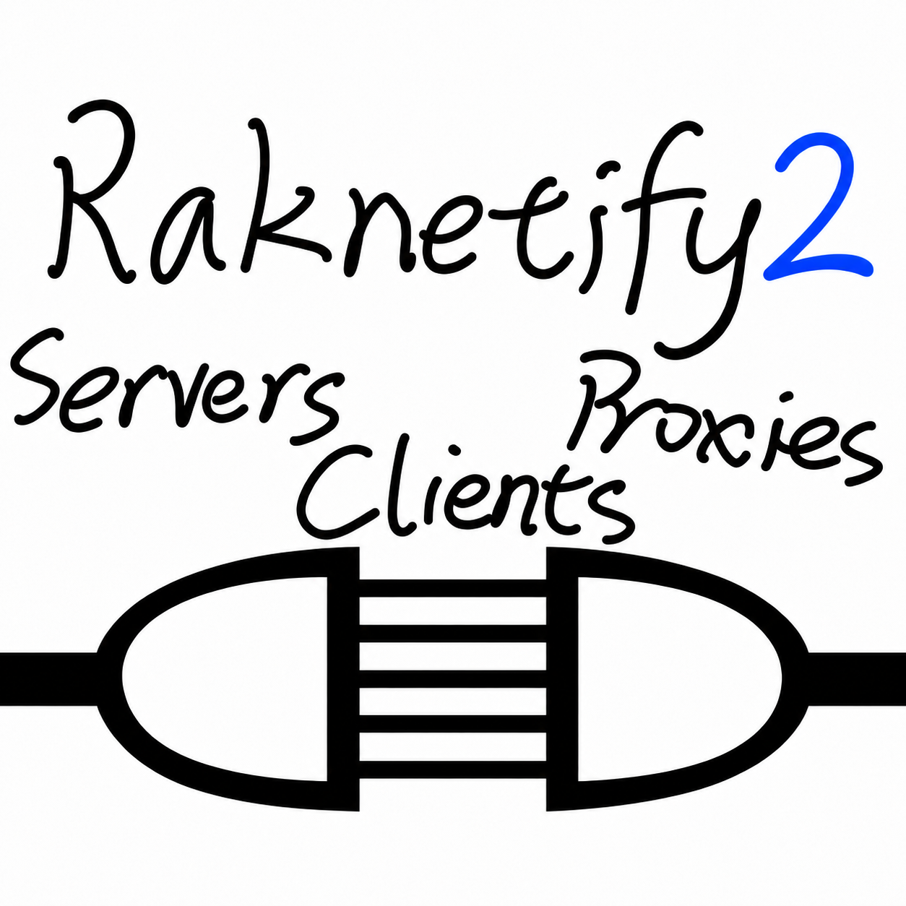

# Raknetify2



Raknetify2 is a Minecraft networking mod that uses RakNet over UDP to help keep multiplayer interactions responsive during packet loss and large world transfers.

## How it works

Minecraft normally uses TCP, which delivers data in one ordered stream. A missing piece can delay everything behind it. Raknetify2 separates traffic into ordering channels, so a delay in one channel need not hold up unrelated traffic in another.

Raknetify2 changes the network transport, not Minecraft's game protocol. Connecting different Minecraft versions still requires a compatible protocol translation setup.

## Downloads

Development builds are available from [GitHub Actions](https://github.com/pjscruggs/raknetify2/actions/workflows/build.yml). Open a successful run for `main` and download its `Artifacts` archive. A GitHub account is required to download these builds.

Use the Fabric JAR for clients and Fabric servers, or the matching plugin for Velocity or BungeeCord. The included `compatibility.json` lists supported Minecraft versions and runtime requirements for the Fabric mod.

## Direct server setup

1. Install the Fabric JAR in the `mods` folder on both the client and server.
2. Allow UDP traffic on the server's Minecraft port, using the same port number as TCP. Configure both the firewall and port forwarding when applicable.
3. Connect using an address such as `raknet;example.com` or `raknet;example.com:25565`.

Install Raknetify2 in place of Raknetify. Do not install both. Normal server addresses continue to use TCP.

## Proxy setup

Install the matching plugin on Velocity or BungeeCord and the Fabric mod on each connecting client. Allow UDP on the proxy's listening port. Clients use the `raknet;` prefix with the proxy address. Backend servers do not need Raknetify2 for this setup.

## Automatic transfers

Fabric servers can select RakNet automatically when transferring players to configured destinations. Create `config/raknetify2-transfers.json` on the server that sends the transfer:

```json
{
  "destinations": [
    {
      "host": "play.example.com",
      "tcpPort": 25565,
      "udpPort": 25570
    }
  ]
}
```

Restart the server after editing this file. Transfer players to the ordinary hostname and TCP port. Clients that advertise support for automatic RakNet transfers use the configured UDP port. Other clients and unmatched destinations keep the original transfer address.

The destination must already accept RakNet on that UDP port. This file does not open a listener or configure a firewall. Hostnames and TCP ports must match an entry exactly, apart from hostname capitalization and equivalent IP spelling.

## License and credits

Raknetify2 is an independently maintained fork of [Raknetify](https://github.com/RelativityMC/raknetify), originally developed by ishland. It retains Raknetify's MIT license and original copyright notices. The networking implementation builds on ishland's Raknetify and [netty-raknet](https://github.com/RelativityMC/netty-raknet).
